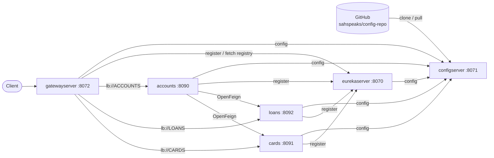

# Bank Microservices with Spring Cloud Config, Eureka and Gateway

Three Spring Boot business microservices (**accounts**, **loans**, **cards**) behind a **Spring Cloud Gateway**. They register with a **Eureka** service registry and get their configuration from a central **Spring Cloud Config Server**, which reads from a GitHub repo. **accounts** calls **loans** and **cards** through **OpenFeign**, using Eureka to find them. Every service is packaged into a container image with **Jib** and run together with **Docker Compose**.

| | |
|---|---|
| Java | 21 |
| Spring Boot | 4.1.1 |
| Spring Cloud | 2025.1.3 |
| Image build | Jib Maven plugin 3.5.2 |
| Registry | Docker Hub, `docker.io/sahspeaks/*` |
| Config source | https://github.com/sahspeaks/config-repo (branch `main`) |
| Service discovery | Netflix Eureka |
| API gateway | Spring Cloud Gateway (WebFlux), discovery-locator routes |
| Database | H2 in-memory, one per service |

---

## 1. Architecture



### Startup sequence

Docker Compose starts the services in this order. Each step waits until the previous services report `UP` on `/actuator/health/readiness` (healthcheck-based `depends_on`).

1. **configserver** clones `config-repo` (`clone-on-start: true`).
2. **eurekaserver** fetches `eurekaserver.yml` from the config server and starts the registry.
3. **accounts, loans and cards** each:
   - read `spring.config.import=configserver:http://configserver:8071`;
   - call `GET http://configserver:8071/{spring.application.name}/{spring.profiles.active}`, for example `/accounts/qa`;
   - merge the returned property sources: `accounts-qa.yml` overrides `accounts.yml`, which overrides the local `application.yml`;
   - register with Eureka at `EUREKA_CLIENT_SERVICE_URL_DEFAULTZONE`.
4. **gatewayserver** starts last, once all three business services are healthy, and builds one route per service it finds in Eureka.

The config import is **not** `optional:`, so a service **fails fast** and exits if the config server can't be reached.

### How a config fetch resolves

The config server maps `/{application}/{profile}` to files in the Git repo:

| Request | Files returned (highest priority first) |
|---|---|
| `/accounts/default` | `accounts.yml` |
| `/accounts/qa` | `accounts-qa.yml`, `accounts.yml` |
| `/accounts/prod` | `accounts-prod.yml`, `accounts.yml` |
| `/eurekaserver/qa`, `/gatewayserver/prod` | `eurekaserver.yml` / `gatewayserver.yml` (there are no profile-specific files for these) |

Try it:

```bash
curl -s localhost:8071/accounts/qa | jq
curl -s localhost:8071/loans/prod | jq
```

Each business-service file sets `build.version` (1.0.0 default, 2.0.0 qa, 3.0.0 prod) and a `<service>.message / contactInfo / onboarding` block. The block binds to `AccountContactInfo`, `LoansContactInfo` and `CardsContactInfo` through `@ConfigurationProperties`.

> `configserver/src/main/resources/config-repo/` is a **local copy** of the Git repo. With `SPRING_PROFILES_ACTIVE=git`, the config server ignores it, so **edit and push the GitHub repo** instead.

---

## 2. Repository layout

```
.
├── configserver/            Spring Cloud Config Server (Git backend)
├── eurekaserver/            Eureka service registry
├── gatewayserver/           Spring Cloud Gateway, the single entry point
├── accounts/                Accounts & customer CRUD; calls loans/cards via OpenFeign
├── loans/                   Loans CRUD
├── cards/                   Cards CRUD
├── build-run.sh             build all six images with Jib + start the stack (see §5)
└── docker-compose/
    ├── default/   docker-compose.yml, .env (git-ignored), .env.example
    ├── dev/       same stack, local sahspeaks/*:dev images
    ├── qa/        same stack, Spring profile qa
    └── prod/      same stack, Spring profile prod
```

Each service also has `src/main/resources/.env` (git-ignored) and `.env.example` (committed), listing the variables its `application.yml` needs when you run it from an IDE. See [section 4](#4-environment-variables).

Each business service follows the same layered structure under `com.learnspring`:

```
controller/  REST endpoints + OpenAPI annotations
service/     I*Service interface + *ServiceImpl (accounts: service/clients/ holds the Feign clients)
repository/  Spring Data JPA repositories
entity/      JPA entities; BaseEntity has audit columns (created_at/by, updated_at/by)
dto/         request/response DTOs with Bean Validation
mapper/      entity <-> DTO mapping
exception/   custom exceptions + @ControllerAdvice GlobalExceptionHandler
audit/       AuditAwareImpl, supplies the "created_by" value for JPA auditing
config/      *ContactInfo, @ConfigurationProperties bound from the config server
constant/    status codes / messages
```

Tables are created from each service's `src/main/resources/schema.sql` into an in-memory H2 database, so **all data is lost on restart**.

---

## 3. Services, ports and endpoints

| Service | Port (container = host) | Useful URLs |
|---|---|---|
| configserver | 8071 | http://localhost:8071/accounts/default |
| eurekaserver | 8070 | http://localhost:8070 (Eureka dashboard) |
| gatewayserver | 8072 | http://localhost:8072/actuator/gateway/routes |
| accounts | 8090 | http://localhost:8090/swagger-ui.html, http://localhost:8090/h2-console |
| cards | 8091 | http://localhost:8091/swagger-ui.html, http://localhost:8091/h2-console |
| loans | 8092 | http://localhost:8092/swagger-ui.html, http://localhost:8092/h2-console |

H2 JDBC URL: `jdbc:h2:mem:testdb`, user `sa`, empty password.

### Calling services through the gateway

The gateway uses the **discovery locator** (`spring.cloud.gateway.server.webflux.discovery.locator.enabled: true`). It creates one route per service registered in Eureka, using the Eureka service ID as the first path segment. Eureka stores IDs in **upper case**, so:

```
http://localhost:8072/ACCOUNTS/api/accounts/...  →  lb://ACCOUNTS  →  accounts:8090/api/accounts/...
http://localhost:8072/LOANS/api/loans/...        →  lb://LOANS     →  loans:8092/api/loans/...
http://localhost:8072/CARDS/api/cards/...        →  lb://CARDS     →  cards:8091/api/cards/...
```

The prefix is stripped before forwarding. You can still call each service directly on its own port.

### accounts: `/api/accounts`

| Method | Path | Notes |
|---|---|---|
| POST | `/create` | Body: `{ "name", "email", "mobileNumber" }` |
| GET | `/getCustomerDetails/{mobileNumber}` | 10-digit mobile number |
| PUT | `/update` | Body: `CustomerDto` including `accountsDto` |
| DELETE | `/delete/{mobileNumber}` | |
| GET | `/java-version` | Returns `JAVA_HOME` and `build.version` from the config server |
| GET | `/contact-info` | Returns the `accounts.*` block from the config server |

### accounts: `/api/customers`

| Method | Path | Notes |
|---|---|---|
| GET | `/fetchCustomerDetails?mobileNumber=` | Customer + account, plus the loan and card fetched from **loans** and **cards** through OpenFeign (`@FeignClient("loans")`, `@FeignClient("cards")`, resolved through Eureka) |

### loans: `/api/loans`

| Method | Path | Notes |
|---|---|---|
| POST | `/create?mobileNumber=` | |
| GET | `/fetch?mobileNumber=` | |
| PUT | `/update` | Body: `LoansDto` |
| DELETE | `/delete?mobileNumber=` | |

### cards: `/api/cards`

| Method | Path | Notes |
|---|---|---|
| POST | `/create?mobileNumber=` | |
| GET | `/fetch?mobileNumber=` | |
| PUT | `/update` | Body: `CardsDto` |
| DELETE | `/delete?mobileNumber=` | |

Quick smoke test, all through the gateway:

```bash
GW=localhost:8072
curl -s -X POST $GW/ACCOUNTS/api/accounts/create \
  -H 'Content-Type: application/json' \
  -d '{"name":"Abhishek","email":"abhi@example.com","mobileNumber":"9876543210"}'
curl -s -X POST "$GW/LOANS/api/loans/create?mobileNumber=9876543210"
curl -s -X POST "$GW/CARDS/api/cards/create?mobileNumber=9876543210"
curl -s "$GW/ACCOUNTS/api/customers/fetchCustomerDetails?mobileNumber=9876543210"   # account + loan + card
curl -s $GW/ACCOUNTS/api/accounts/contact-info
```

---

## 4. Environment variables

The `application.yml` files contain `${...}` placeholders with **no defaults**. Every variable below must be set, both in Docker and when running from an IDE.

| Variable | Used by | Compose value | Purpose |
|---|---|---|---|
| `SPRING_PROFILES_ACTIVE` | configserver | `git` | Enables the Git backend |
| `SPRING_PROFILES_ACTIVE` | all other services | `default` / `qa` / `prod` (from the Compose folder) | Selects `<app>-<profile>.yml` from the config repo |
| `SPRING_CONFIG_IMPORT` | all except configserver | `configserver:http://configserver:8071` | Config server location. The host name is the Compose service name. |
| `EUREKA_CLIENT_SERVICE_URL_DEFAULTZONE` | accounts, loans, cards, gatewayserver | `http://eurekaserver:8070/eureka/` | Eureka registry URL. gatewayserver reads it through `config-repo/gatewayserver.yml`. |
| `SPRING_APPLICATION_NAME` | all except configserver | service name | Must match the file prefix in the config repo |
| `ENCRYPT_KEY` | configserver | `${ENCRYPT_KEY}` from `.env` | Symmetric key for the `/encrypt` and `/decrypt` endpoints and `{cipher}` values |

### Docker secrets: `docker-compose/<env>/.env`

Each Compose folder has a git-ignored `.env` next to its `docker-compose.yml`, created from the committed `.env.example`:

```bash
cp docker-compose/default/.env.example docker-compose/default/.env
# then edit it and set a real ENCRYPT_KEY
```

- Compose reads `.env` from the **same folder as the Compose file**. That works with `cd docker-compose/default && docker compose up`, with `docker compose -f docker-compose/default/docker-compose.yml up` from the repo root, and with `build-run.sh`.
- `ENCRYPT_KEY` is written as `${ENCRYPT_KEY:?...}`, so a missing value stops Compose with a clear error instead of starting the config server without a key.
- `docker compose config` shows what Compose will actually use. **It prints the secrets**, so don't paste its output anywhere public.
- Changing `ENCRYPT_KEY` makes existing `{cipher}...` values in `config-repo` unreadable. Re-encrypt them with the new key.
- The `.env.example` files still list `RABBITMQ_USERNAME` / `RABBITMQ_PASSWORD` from the earlier Spring Cloud Bus setup. Nothing uses them now.

### Local run: `<service>/src/main/resources/.env`

Each service has a git-ignored `.env` with the values for running on your machine (`localhost` instead of Compose host names), created from its committed `.env.example`:

| Service | Variables |
|---|---|
| configserver | `SPRING_PROFILES_ACTIVE=git`, `ENCRYPT_KEY` |
| eurekaserver | `SPRING_PROFILES_ACTIVE`, `SPRING_CONFIG_IMPORT` |
| accounts, loans, cards, gatewayserver | `SPRING_PROFILES_ACTIVE`, `SPRING_CONFIG_IMPORT`, `EUREKA_CLIENT_SERVICE_URL_DEFAULTZONE` |

Spring Boot does **not** read these files by itself. Load one into the run configuration, for example with IntelliJ's EnvFile plugin, or export it in the shell before `mvn spring-boot:run` (see [Option C](#option-c-run-from-source--ide)).

---

## 5. Setup

### Prerequisites

- JDK 21
- Maven 3.9+ (each service except accounts ships `mvnw`; a system `mvn` works for all of them)
- Docker Desktop, with Compose v2
- A Docker Hub account, only needed to **push** images

### The four Compose environments

All four files in `docker-compose/` are identical except for the image tag and the Spring profile:

| Folder | Images | `SPRING_PROFILES_ACTIVE` (configserver always uses `git`) | Built by `build-run.sh` with |
|---|---|---|---|
| `dev` | `sahspeaks/<service>:dev`, built on your machine | `default` | `mvn compile jib:dockerBuild -Djib.to.image=sahspeaks/<service>:dev` (no push, no `docker login`) |
| `default` | `sahspeaks/<service>:latest` | `default` | `mvn compile jib:build` (pushes to Docker Hub) |
| `qa` | `sahspeaks/<service>:latest` | `qa` | `mvn compile jib:build` |
| `prod` | `sahspeaks/<service>:latest` | `prod` | `mvn compile jib:build` |

All four use the **same container names and host ports**, so only one stack can run at a time. Stop one before starting another:

```bash
docker compose -f docker-compose/default/docker-compose.yml down
./build-run.sh dev
```

### Option A: build and run everything with `build-run.sh`

`build-run.sh` in the repo root does the whole flow in one command:

1. Builds all six images, in startup order: `configserver` → `eurekaserver` → `accounts` → `loans` → `cards` → `gatewayserver`:
   - `dev`: into your **local** Docker only, as `sahspeaks/<service>:dev` (`jib:dockerBuild`);
   - `default` / `qa` / `prod`: builds them and **pushes** them to Docker Hub as `:latest` (`jib:build`).
2. Starts the stack with `docker compose -f docker-compose/<env>/docker-compose.yml up -d --remove-orphans`.
3. Prints `docker compose ps` and the command for following the logs.

```bash
chmod +x build-run.sh                 # once, otherwise: "zsh: permission denied"
docker login                          # once, only needed for default/qa/prod (they push)

./build-run.sh dev                    # build locally (:dev) + run docker-compose/dev, no push
./build-run.sh dev --no-build         # rerun the dev stack with the :dev images you already have
./build-run.sh                        # build + push + run, using docker-compose/default
./build-run.sh default --no-build     # skip the Maven/Jib step, just (re)start the stack
./build-run.sh qa                     # build + push + run docker-compose/qa (profile qa)
./build-run.sh prod                   # build + push + run docker-compose/prod (profile prod)
```

| Argument | Values | Default | Effect |
|---|---|---|---|
| 1st | `dev`, `default`, `qa`, `prod` | `default` | Picks the Compose file `docker-compose/<env>/docker-compose.yml`. Any other value exits with a usage message. |
| 2nd | `--no-build` | build | Skips the image build and only runs Compose |

Behaviour to know:

- **Stops on the first error** (`set -euo pipefail`). If one service's build fails, the later services aren't built and the stack isn't started.
- **`--remove-orphans`** deletes containers from earlier runs whose service is no longer in the Compose file (for example the old `rabbitmq` container).
- **Compose may start the old images.** `jib:build` pushes the new images to Docker Hub, but `docker compose up` keeps using a local `sahspeaks/*:latest` image if one exists and doesn't pull the new one. To be sure you run what you just built, run `docker compose -f docker-compose/<env>/docker-compose.yml pull` before `up`, or use the `dev` stack.
- **Warnings during the Jib step are normal.** Lines like `The base image requires auth`, `credential helper ... has nothing for server URL` and `'mainClass' ... ${start-class}` don't mean anything failed. The build only failed if you see `[ERROR]` / `BUILD FAILURE`.

### Option B: run the published images without building

```bash
cd docker-compose/default
docker compose up -d
docker compose ps          # every service should show "(healthy)"
docker compose logs -f accounts
```

Stop and remove everything:

```bash
docker compose down
```

### Option C: run from source / IDE

Start the services in this order, each with the variables from its `src/main/resources/.env`:

```bash
cp configserver/src/main/resources/.env.example configserver/src/main/resources/.env   # once per service, then edit

(cd configserver && set -a && . src/main/resources/.env && set +a && mvn spring-boot:run)
```

1. **configserver**: wait for `Started ConfigserverApplication`.
2. **eurekaserver**: open http://localhost:8070.
3. **accounts**, **loans** and **cards**: they appear in the Eureka dashboard.
4. **gatewayserver**.

From the host, the config server and Eureka are at `localhost`. `configserver` and `eurekaserver` are host names that only resolve inside the Compose network.

---

## 6. Building images with Jib and publishing to Docker Hub

Each `pom.xml` configures Jib like this:

```xml
<plugin>
  <groupId>com.google.cloud.tools</groupId>
  <artifactId>jib-maven-plugin</artifactId>
  <version>3.5.2</version>
  <configuration>
    <to>
      <image>docker.io/sahspeaks/${project.artifactId}:latest</image>
    </to>
  </configuration>
</plugin>
```

`${project.artifactId}` resolves to the service name, which gives six images: `sahspeaks/configserver`, `eurekaserver`, `gatewayserver`, `accounts`, `loans` and `cards`.

### What `mvn compile jib:build` does

```bash
cd accounts
mvn compile jib:build
```

1. **`compile`**: Maven compiles `src/main/java` into `target/classes`, and Lombok runs as an annotation processor. Jib needs compiled classes, but not a fat JAR, so `package` isn't required.
2. **`jib:build`**:
   - Pulls the **base image** metadata. None is configured, so Jib 3.5 picks **`eclipse-temurin:21-jre`** to match `java.version=21`. It's Ubuntu-based, which is why `curl` is available for the healthcheck.
   - Builds layers **without a Dockerfile and without the Docker daemon**:
     - dependencies (rarely change)
     - snapshot dependencies
     - resources (`application.yml`, `schema.sql`)
     - classes (your code, which changes most often)

     When you only change code, only the small classes layer is re-uploaded.
   - Sets the entrypoint to `java -cp @/app/jib-classpath-file com.learnspring.AccountsApplication`.
   - **Pushes straight to Docker Hub** (`docker.io/sahspeaks/accounts:latest`) over the registry HTTP API.
3. Docker Compose later pulls that tag from Docker Hub when you run `docker compose up` or `docker compose pull`.

```
source ──mvn compile──▶ target/classes ──jib:build──▶ Docker Hub (sahspeaks/accounts:latest)
                                                              │
                                              docker compose pull / up
                                                              ▼
                                                     local container
```

> The git-ignored `src/main/resources/.env` file is copied into the image's resources layer as well. Spring never reads it there, but keep real secrets such as `ENCRYPT_KEY` out of it if you push images to a public registry.

### Authentication to Docker Hub

Jib reads the same credentials Docker uses:

```bash
docker login            # stores creds in the macOS keychain (credsStore: desktop)
mvn compile jib:build   # Jib picks them up automatically
```

In CI, or without `docker login`:

```bash
mvn compile jib:build \
  -Djib.to.auth.username=sahspeaks \
  -Djib.to.auth.password=$DOCKERHUB_TOKEN     # use a Docker Hub access token, not your password
```

### Build all six images

Use `./build-run.sh` (see [section 5](#option-a-build-and-run-everything-with-build-runsh)). To build only, without starting anything:

```bash
for s in configserver eurekaserver accounts loans cards gatewayserver; do (cd $s && mvn -q compile jib:build) || break; done
```

### Other Jib goals

| Command | Result |
|---|---|
| `mvn compile jib:build` | Build and push to the registry. No Docker daemon needed. |
| `mvn compile jib:dockerBuild` | Build into the **local** Docker daemon only, with no push. Good for testing. |
| `mvn compile jib:buildTar` | Write `target/jib-image.tar` (`docker load < target/jib-image.tar`) |

### Things to know

- **"Created 56 years ago"**: Jib sets the image timestamp to the Unix epoch so builds are reproducible. This is expected.
- **Architecture**: images are currently built for **linux/amd64** only. On an Apple Silicon Mac they run under emulation, which is why the services take about 20 seconds to boot. See [Future implementations](#9-future-implementations).
- **The `latest` tag is overwritten on every push**, so there is no way to roll back. Prefer versioned tags (see below).
- The accounts `pom.xml` also has a commented-out **Buildpacks** config (`spring-boot:build-image`). That's an alternative to Jib and isn't currently used.

---

## 7. Docker Compose (`docker-compose/<env>/docker-compose.yml`)

All six containers join the user-defined bridge network `microservices-network`, so they reach each other by **service name** (`configserver`, `eurekaserver`, ...).

Every service is written with its keys in the same order: `image`, `container_name`, `ports`, `environment`, `depends_on`, `healthcheck`, `networks`. Each service has a readiness healthcheck on its own port:

```yaml
healthcheck:
  test: ["CMD-SHELL", "curl -fs http://localhost:<port>/actuator/health/readiness | grep UP || exit 1"]
  interval: 10s
  timeout: 5s
  retries: 10
  start_period: 20s
```

The readiness endpoint exists because every service's `application.yml` enables the health probes:

```yaml
management:
  health:
    readiness-state:
      enabled: true
    liveness-state:
      enabled: true
  endpoint:
    health:
      probes:
        enabled: true
```

Startup ordering (`depends_on` with `condition: service_healthy`):

| Service | Waits for |
|---|---|
| configserver | – |
| eurekaserver | configserver |
| accounts, loans, cards | configserver, eurekaserver |
| gatewayserver | configserver, eurekaserver, accounts, loans, cards |

> A plain `depends_on: [configserver]` only waits for the container to *start*. The services then call the config server before its Tomcat is listening, get `Connection refused`, and exit with `ConfigClientFailFastException`. The healthcheck prevents this.

Useful commands:

```bash
docker compose pull                    # fetch newest images from Docker Hub
docker compose up -d                   # start (recreates containers whose image changed)
docker compose ps                      # status + health
docker compose logs -f configserver
docker compose restart accounts
docker compose down                    # stop + remove containers and network
```

---

## 8. Refreshing config without restarting

accounts, loans and cards expose the `refresh` actuator endpoint.

1. Edit a file in https://github.com/sahspeaks/config-repo and push.
2. Refresh each service that should pick up the change:
   ```bash
   curl -X POST localhost:8090/actuator/refresh     # accounts
   curl -X POST localhost:8092/actuator/refresh     # loans
   curl -X POST localhost:8091/actuator/refresh     # cards
   ```
3. `curl localhost:8090/api/accounts/contact-info` now shows the new values. `@ConfigurationProperties` beans are re-bound. `@Value` fields such as `build.version` are **not** updated unless the bean is `@RefreshScope`.

`busrefresh` is still listed in `management.endpoints.web.exposure.include`, but no service has the Spring Cloud Bus dependency, so the endpoint doesn't exist. Refreshing all services with a single call, or automatically on `git push` with a webhook, needs Bus and a broker again (see [Future implementations](#9-future-implementations)).

**Encrypting secrets in the config repo:**

```bash
curl -s localhost:8071/encrypt -d 'my-db-password'     # → 3f9a...
# in config-repo/accounts-prod.yml:
#   db.password: '{cipher}3f9a...'
```

The config server decrypts `{cipher}` values with `ENCRYPT_KEY` before serving them.

---

## 9. Future implementations

**Build and release**
- [ ] Add a parent/aggregator `pom.xml` so one `mvn compile jib:build` builds every service. Add the Maven wrapper to accounts.
- [ ] Tag images with the project version as well as `latest`, e.g. `<tags><tag>${project.version}</tag></tags>`. Set `version: 1.0.0` instead of `0.0.1-SNAPSHOT`.
- [ ] Build multi-arch images (`<from><platforms>` with `linux/amd64` and `linux/arm64`) so Apple Silicon machines run them natively.
- [ ] Add a GitHub Actions pipeline: test → `jib:build` with Docker Hub token secrets → optional deploy.

**Gateway**
- [ ] Set `discovery.locator.lower-case-service-id: true`, or define explicit routes (e.g. `/bank/accounts/**`), instead of upper-case service IDs in URLs.
- [ ] Add gateway filters: path rewriting, request/response headers, a correlation ID.

**Configuration and security**
- [ ] Bring back Spring Cloud Bus (RabbitMQ or Kafka) + `spring-cloud-config-monitor` for one-call `busrefresh` and webhook-driven refresh. Until then, remove `busrefresh` from the actuator exposure and the `RABBITMQ_*` lines from `.env.example`.
- [ ] Move from `.env` to Docker secrets or a secret manager (Vault, AWS Secrets Manager) for real deployments.
- [ ] Reduce actuator exposure from `"*"` to only what's needed, and remove `shutdown` outside dev.
- [ ] Protect the config server with Spring Security (basic auth), and use a GitHub token or deploy key if `config-repo` becomes private.
- [ ] Add `spring.cloud.config.retry` (+ `spring-retry`) on clients for extra startup resilience.

**Data**
- [ ] Replace H2 with MySQL or PostgreSQL containers so data survives restarts. Use per-service databases and healthchecks.

**Microservice patterns (next steps of the course)**
- [ ] **Resilience**: Resilience4j circuit breaker, retry and timeouts on the gateway and around the Feign calls.
- [ ] **Observability**: Micrometer + Prometheus + Grafana for metrics, Loki for logs, Tempo/OpenTelemetry for traces.
- [ ] **Security**: OAuth2 / Keycloak at the gateway.
- [ ] **Event-driven**: Spring Cloud Stream on RabbitMQ or Kafka for async notifications.
- [ ] **Deployment**: Kubernetes manifests / Helm charts, using the existing `/actuator/health/liveness` and `/readiness` probes.

---

## 10. Troubleshooting

| Symptom | Cause | Fix |
|---|---|---|
| `failed to resolve reference "docker.io/sahspeaks/<service>:dev": not found` | The `:dev` image hasn't been built yet, so Compose tried Docker Hub | `./build-run.sh dev` (without `--no-build`) |
| A service stays `(health: starting)` and later `(unhealthy)` | Its image was built before the health-probe settings were added, so `/actuator/health/readiness` returns 404 | Rebuild the images (`./build-run.sh <env>`) |
| `ConfigClientFailFastException ... Connection refused` for `http://configserver:8071/...` | Service started before the config server was ready | Keep the healthcheck `depends_on`, then `docker compose up -d` again |
| Same error when running from the IDE | `SPRING_CONFIG_IMPORT` points to `configserver` | Use `configserver:http://localhost:8071` (see the service's `.env.example`) |
| `Could not resolve placeholder 'SPRING_CONFIG_IMPORT'` (or another variable) | Env vars not set | Set every variable in [section 4](#4-environment-variables), e.g. load the service's `.env` |
| A service is missing from the Eureka dashboard | `EUREKA_CLIENT_SERVICE_URL_DEFAULTZONE` wrong or not set | `http://eurekaserver:8070/eureka/` in Compose, `http://localhost:8070/eureka/` locally |
| Gateway returns `404` | Path doesn't start with the upper-case service ID, or the service hasn't registered yet | Use `/ACCOUNTS/...`, check http://localhost:8072/actuator/gateway/routes |
| `/fetchCustomerDetails` fails with a Feign error | loans or cards not registered in Eureka | Check the Eureka dashboard; wait for registration (about 30 s) |
| `/contact-info` shows `DEFAULT` instead of `QA` | Stack started from `default/` or `dev/` | Use `./build-run.sh qa`, or set `SPRING_PROFILES_ACTIVE` |
| Service reachable in the container but not from the host | Host:container port mismatch | Check the `ports:` mapping against `server.port` |
| `jib:build` → `401 Unauthorized` | Not logged in to Docker Hub | `docker login`, or pass `-Djib.to.auth.*` |
| Pushed a new image but Compose runs the old one | Local cache of `latest` | `docker compose pull && docker compose up -d` |
| `required variable ENCRYPT_KEY is missing a value` | No `docker-compose/<env>/.env` | `cp docker-compose/<env>/.env.example docker-compose/<env>/.env` and fill it in |
| `Bind for 0.0.0.0:8090 failed: port is already allocated` | Another stack, or an app in your IDE, is using the port | `docker compose -f docker-compose/<other>/docker-compose.yml down`, or stop the IDE app |
| `zsh: permission denied: ./build-run.sh` | Script isn't executable | `chmod +x build-run.sh` |
| Refresh happened but `/java-version` still shows the old `build.version` | `@Value` fields aren't re-bound on refresh | Add `@RefreshScope` to the bean, or restart the service |
